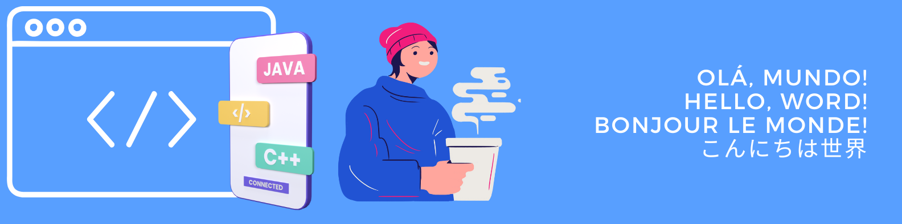

  

<table>
  <tr>
    <td valign="middle" width="68%">
      <h1>JOÃO VICTOR GONZAGA</h1>
      <h3>Desenvolvedor Web em formação · Técnico em Informática</h3>
      
<code>JUJUTSU TECH // ARQUIVO DE DESENVOLVEDOR Nº 001</code>

      
<strong>Expansão de domínio:</strong> transformar ideias em projetos reais.

      
Entre linhas de código, bugs e novas descobertas, sigo evoluindo uma missão de cada vez.

      

        
        
      

    </td>
    <td align="center" valign="middle" width="32%">
      
    </td>
  </tr>
</table>

---

## 🩸 01 — ARQUIVO DO FEITICEIRO

> *“O próximo nível não aparece do nada. É construído a cada tentativa.”*

Sou João Victor, formado como **Técnico em Informática** e desenvolvedor web em formação. Gosto de transformar o que aprendo em projetos práticos, explorando desenvolvimento web, bancos de dados e criação de sistemas que resolvam problemas reais.

Acredito que tecnologia não é só fazer o código funcionar: também é pensar na experiência de quem vai usar, cuidar da organização e prestar atenção aos detalhes.

<table>
  <tr>
    <td width="34%"><strong>CLASSIFICAÇÃO</strong></td>
    <td>Desenvolvedor em formação</td>
  </tr>
  <tr>
    <td><strong>FORMAÇÃO</strong></td>
    <td>Técnico em Informática</td>
  </tr>
  <tr>
    <td><strong>FOCO</strong></td>
    <td>Desenvolvimento web · Banco de dados · Sistemas</td>
  </tr>
  <tr>
    <td><strong>OBJETIVO</strong></td>
    <td>Evoluir por meio de projetos, colaboração e aprendizado contínuo</td>
  </tr>
  <tr>
    <td><strong>STATUS DA MISSÃO</strong></td>
    <td>Aberto a oportunidades e colaborações</td>
  </tr>
</table>

## ⚔️ 02 — TÉCNICAS & ARSENAL

Tecnologias que fazem parte dos meus estudos e projetos:

**Desenvolvimento web**

  
  
  
  
  
  

**Programação & dados**

  
  
  
  

**Ferramentas**

  
  

## 🗂️ 03 — REGISTRO DE MISSÕES

| Projeto | Registro | Tecnologias |
|:--|:--|:--|
| **Bem Estar Farmácia** | Sistema acadêmico com banco de dados relacional, inspirado em uma empresa familiar | `PHP` `MySQL` `JavaScript` |
| **Próximas missões** | Novos projetos e experimentos em construção | `Em breve` |

## 📊 04 — RELATÓRIO DE ENERGIA

  
  

---

  <h3>領域展開 — EXPANSÃO DE DOMÍNIO</h3>
  
<strong>O limite de hoje é só o ponto de partida da próxima versão.</strong>

  
Vamos construir algo incrível?

  <a href="https://github.com/joaovictorcsharp">GitHub</a> ·
  <a href="https://www.linkedin.com/in/joao-victor-gonzaga-de-carvalho-716a94231">LinkedIn</a>
    
  

